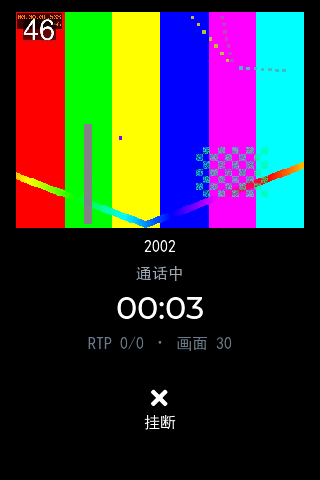

# 视频上屏链路验证

> 从 RTP 收到一个 H.264 包，到它变成屏幕上的一块像素，中间有七道手。
> 这份文档记录怎么证明**每一道都对**，以及为什么不能用"看着挺清楚"当结论。

被测对象：室内机（LVGL 320×480 竖屏 + PC 端 SDL 模拟）
涉及代码：`src/media/h264_depack.c` → `src/media/vdec_ffmpeg.c` → `src/media/yuv2rgb.c`
→ `src/app/app_video.c` → `src/app/app_events.c` → `src/ui/ui_call.c`

---

## 1. 为什么上屏要另做一套验证

接收链路的验证（《视频接收链路验证.md》）只回答到"解码器吐出的 YUV 和参考帧逐字节相同"。
从那里到屏幕上，还有三步：

| 步骤 | 可能出的错 | 屏幕上的表现 |
| --- | --- | --- |
| YUV420P → RGB565 缩放 | 系数写错、把有限量程当全量程、U/V 平面串了 | 偏绿/偏紫/整幅发灰 |
| 按行拷进槽位 | 没按 linesize 走 | 画面斜切、右边缘一条花 |
| LVGL 绘制 | 控件尺寸与图片尺寸不一致、inner_align 选了会缩放的值 | 拉伸变形、只显示一部分 |
| 线程交接 | 解码线程写的时候主线程正在画 | 撕裂、偶发闪一下别的画面 |

**这几种故障在 320×480 的小屏上都长得像"信号不好"。** 人眼在动态画面里对
"这帧颜色是不是有点偏"极不敏感，尤其画面本来就在动、还有马赛克。所以：

- 不做"看着对"，做**抓屏 + 逐像素比**。
- 抓屏里的每一个不同像素都能指到坐标上，并且在同一个坐标上说清差多少。

---

## 2. 链路与线程边界

```
  RTP 线程（app_sip recv_loop）
      │  收到视频包
      ▼
  h264_depack          单 NAL / STAP-A / FU-A → 按 RTP 时间戳(90kHz)切 AU
      │
      ▼
  vdec (libavcodec)    AU → YUV420P（PC 软解；板子换 MPP，这一层不动）
      │
      ▼
  yuv2rgb_fit          640×480 → 288×216（等比装进控件，最近邻）
  yuv2rgb_565          YUV420P → RGB565，顺手缩小
      │
      ▼
  app_video 槽位       3 个槽，FREE → READY → SHOWN → FREE
      │
      │  app_events_post(EV_VIDEO_FRAME, 槽号, 帧序号)   ← 跨线程唯一通道
      ▼
  ─────────────── 线程边界（LVGL 只能在主线程碰）───────────────
      │
      ▼
  ui_call 事件回调      app_video_disp_acquire() → lv_image_set_src()
      │
      ▼
  LVGL 绘制            RGB565 图 → 屏幕（PC 是 888 的 SDL 表面）
```

跨线程只有**一处**：事件总线。解码、转换全在 RTP 线程，`lv_*` 调用全在主线程。
这条纪律是 LVGL 项目的红线，也是面试里最容易被追问的点（"你怎么保证 LVGL 线程安全"）。

---

## 3. 三个关键设计决定

### 3.1 为什么自己转 RGB565，不把 YUV 直接丢给 LVGL

LVGL 10 确实支持 YUV 图像格式，但：

1. **尺寸对不上**。源 640×480，控件 288×216。让 LVGL 每帧缩放一张 640×480 的图，
   GPU/软件都要处理 460KB 的源；我们先缩到 288×216 再交出去，只有 124KB。
2. **解码器的缓冲靠不住**。`vframe_t` 的指针在下一次 `vdec_get` 就失效，
   要交给 LVGL 就必须拷贝 —— 每帧拷 460KB（YUV）vs 转成 124KB（RGB565），
   转换和拷贝是同一个循环，顺手做了还省 3/4 的带宽。
3. **可测**。转换逻辑抽成 `yuv2rgb.c` 就能被 UT 直接调，用标准色逐像素核对；
   交给 LVGL 内部去缩放，就只能靠"看"。

### 3.2 为什么走"槽位 + 状态机"，而不是一帧一个 malloc

三个槽，状态机 `FREE → READY → SHOWN → FREE`：

- **FREE**：解码线程可以写
- **READY**：已写满，等主线程取
- **SHOWN**：LVGL 正在显示，谁都不能写

不变式：解码线程只写 FREE，主线程只把 SHOWN 改回 FREE。两边都不动对方管的槽。

为什么是 3 个：1 个正在显示 + 1 个已备好 + 1 个空闲可写。
少于 3 个，在 30fps 源和 ~28Hz 的 UI 取帧节拍错开时会频繁顶掉帧。

为什么还要上锁：不是为了防同时写（不变式已经保证了），而是为了**内存屏障**。
解码线程"写像素"在前、"置 READY"在后，没有屏障的话 ARM 上主线程可能先看到
READY 再看到旧像素 —— 表现是偶发花屏，**板上出现、PC 上永远复现不了**。
25fps 上锁的开销可以忽略，换掉一个只在目标机上出现的问题，划算。

### 3.3 槽位占满时：丢旧留新

一开始写的是"槽位满就丢掉新帧"。测出来 `180 帧里有 12 帧被丢`，看着像小问题，
但语义是错的：**丢掉新帧意味着画面停在旧帧上，延迟会随时间累积**（越看越滞后）。

改成顶掉一个还没被取走的 READY：

```
disp{shown=168, replace=12, drop=0}
```

`replace` 是"被更新的一帧顶掉了"，`drop` 是"连可顶的都没有" —— 后者正常应为 0。
顶掉的结果是延迟恒定在一帧，代价是跳过一小段。所有实时流都是这个策略
（WebRTC 的 jitter buffer 同理）。

**绝不在解码线程里等主线程来取**：等 → RTP 收包跟不上 → 丢包 → 花屏。
丢帧只是跳一下，丢包是烂一片，严重程度不在一个量级。

---

## 4. 为什么抓屏能做到逐像素相同

链路上有一次颜色格式的往返：

```
解码 YUV420P ──yuv2rgb──> RGB565 ──LVGL──> 屏幕(ARGB8888) ──snapshot──> RGB565
```

`RGB565 → 888 → RGB565` 这一步是**可逆**的：
5 位→8 位用位复制补低位（`r5<<3 | r5>>2`），再 `>>3` 就精确回到原值；6 位同理。

所以只要满足三个前提，逐像素必须完全相同（不是"误差很小"）：

1. 缩放规则一致。C 侧用最近邻 + 像素中心对齐，`disp_compare.py` 用同一个公式
   （`sx = (2x+1)·sw // (2·dw)`）。用双线性就复现不了 —— 那是浮点舍入的泥潭。
2. 控件尺寸 == 图片尺寸。任何缩放都会走 LVGL 的变换路径，引入滤波。
3. 没有圆角裁剪（见 6.3）。

实测：**62208/62208 逐像素相同**（288×216）。

---

## 5. 怎么跑

```bash
bash scripts/dev.sh build          # 先编译
bash scripts/duo_disp_test.sh      # 默认推 6 秒，第 45 帧抓屏
bash scripts/duo_disp_test.sh 8 60 # 推 8 秒，第 60 帧抓屏
make duo-disp                      # 同上（默认参数）
```

脚本做的事：

1. 起室内机：`SIP_VIDEO_SINK=disp` + `SIP_VIDEO_DISP_SHOT=duo_disp_screen.ppm`
   + `SIP_VIDEO_DISP_SHOT_AT=45`
2. 起客户端：只负责建立通话（`SIP_VIDEO_SINK=file`，让 SDP 里带 m=video）
3. **ffmpeg** 推 6 秒 640×480 H.264 到室内机的 RTP 端口
4. 室内机收到第 45 帧时抓屏 → PPM
5. `disp_compare.py` 拿抓屏和参考 YUV 的第 46 帧比（注意 0 基/1 基，见 6.2）

推流方用 ffmpeg 而不是我方实例，理由和接收链路验证一样：**责任边界**。
出问题一定在接收侧（解包/解码/转换/绘制），不用去怀疑编码器。

想肉眼看抓屏：

```bash
/c/msys64/mingw64/bin/ffmpeg -y -i bin/duo_disp_screen.ppm bin/duo_disp_screen.png
```

---

## 6. 实测结果

```
[video] 上屏目标框 288x216
[video] 上屏 → lv_image 288x216 (YUV420P→RGB565 最近邻缩放)
[video] 解码输出 640x480 → 上屏 288x216（first frame pts=1205700266）
[disp] 抓屏 → duo_disp_screen.ppm  screen=320x480  img_box=16,12,288,216  dec_frame=47
[video] stats(hangup) pkt=901 au=180 nal=190 stap=4 fu=181
        drop{type=0,big=0,slow=0} fu_broken=0
        dec{fed=180,frame=180,err=0} 640x480 sink_frames=180
        disp{shown=168,replace=12,drop=0}
```



*（`docs/img/video_disp_screen.png`：实机抓屏。测试卡上的烧录帧号 46 对应参考帧 #47 ——
ffmpeg 的 `%{n}` 是 0 基，这个 1 帧的偏移一开始差点被我当成"解码延迟"去查。）*

```
参考帧         #47（参考文件共 300 帧）
缩放           640x480 → 288x216（最近邻，像素中心对齐）
抓屏区域       屏幕(16,12) 288x216，整屏 320x480
逐像素相同     62208/62208    ← 完全一致
```

数字读法：

| 数字 | 含义 | 为什么是这个值 |
| --- | --- | --- |
| `dec{fed=180,frame=180,err=0}` | 180 个 AU 解出 180 帧，零错误 | 6 秒 30fps |
| `fu_broken=0` | 没有半截的 FU-A | 本地回环不丢包 |
| `sink_frames=180` | 180 帧全部转换并提交 | 每帧都成功转了 |
| `shown=168` | 进了 LVGL 的帧数 | UI 取帧节拍 ~28Hz，比 30fps 源略慢 |
| `replace=12` | 12 帧被更新帧顶掉 | 正常，延迟恒定在一帧 |
| `drop=0` | 没有因无槽可用而丢 | 3 槽 + 丢旧留新足够 |

`shown` 不等于 180 不是缺陷：那 12 帧在被显示前就被更新的一帧取代了。
如果一定要 180 帧全显示，就得加缓冲 → 延迟增加，对讲场景是倒退。

---

## 7. 踩过的坑（都会重犯，记下来）

### 7.1 抓屏被重复触发 → 文件与帧号对不上，结果全错

第一版 `s_shot_at` 判断写成 `!s_shot_timer && frame_no >= shot_at`。
抓完之后 `s_shot_timer = NULL`，下一帧条件又成立 → **每 3 帧抓一次，抓了 40 多次**。
落盘文件是最后一次（第 180 帧）写的，而 `parse_log` 取的是**第一条**记录（第 47 帧）。

结果：62208 个像素里 8839 个不同，PSNR 14.2 dB，"差异集中在底部"。
看起来像"只画了一半"这种严重 bug，实际是两个不同帧在比。

修法：加 `s_shot_done` 只抓一次；`disp_compare.py` 改成取**最后一条**记录
（万一是重复触发，落盘文件一定以最后一次为准）。

> 教训：**验收工具本身的 bug 最容易被误读成产品 bug。**
> 所以脚本里加了"差异形态判读"，并且把帧号一起打进日志 —— 让"比错对象"这种情况
> 有据可查，而不是盯着 PSNR 猜。

### 7.2 圆角裁剪必然引入差异

第一版视频窗口做成 14px 圆角（好看）。但圆角会把四角裁成背景色，
那部分像素**必然**和参考帧不同 —— 逐像素比对就废了，只能引入掩膜（脆弱）
或者退化成"看个大概"。

取舍：**选可验证**，视频区改直角，用 1px 描边保住"画面窗口"的观感。
产品上真要圆角，就把验证改成"掩掉四角后比对"，并在文档里写明掩膜半径 ——
但那是另一套复杂度，当前不值得。

### 7.3 新增文案导致字体缺字

"等待画面"四个字不在已有子集字库里（`gen_font.py` 按源码里的字符串字面量收集）。
不重跑就是四个方框。新增任何界面文案后必须：

```bash
python scripts/gen_font.py     # 重新扫源码 → 生成子集
```

本次从 295 字涨到 421 字（汉字 307），16px 字号 247KB、24px 403KB。

### 7.4 抓屏要延迟 80ms，否则抓到上一帧

`lv_image_set_src()` 只是把描述符挂上去并标脏，真正画要到下一次
`lv_timer_handler` 的刷新阶段。所以刚收到帧就抓，抓到的是上一帧。

表现很有迷惑性：比对结果"整体差一帧"，很容易被当成"解码延迟"去查网络。
修法：抓屏用一次性 `lv_timer` 延迟 80ms，让这一帧真的进了帧缓冲。

### 7.5 `lv_font_montserrat_28` 不存在

`lv_conf.h` 只开了 12~24 和 32、48 等部分字号，写 `28` 直接编译失败。
用之前先确认字号在配置里。

---

## 8. 代价清单（面试要能说清）

| 项 | 代价 | 换到了什么 |
| --- | --- | --- |
| 3 个槽位常驻不释放 | 288×216×2×3 ≈ 356KB | 挂断时不 free，避免 GUI 还在画就被回收（use-after-free 只在高负载时序下崩） |
| `LV_USE_SNAPSHOT 1` | 约几 KB 代码 + 抓屏时 307KB 临时缓冲 | 能抓屏做数值验收；量产可关 |
| 事件总线 30ms 分发 | 每个 timer 周期一次遍历 | 跨线程收口，LVGL 只被主线程碰 |
| 每帧一次上锁 | 忽略不计 | ARM 上的内存屏障，消除"只在上海思/板子出现"的花屏 |

**为什么槽位不 free**：`app_video_close()` 是在 RTP 线程里调的，而主线程可能
正在用槽里的像素画图（`lv_image` 只存指针不拷贝）。这时候 `free` 就是教科书级的
use-after-free：挂断瞬间偶发崩溃，换个时序就复现不了。356KB 换掉这类问题，划算。

---

## 9. 板端怎么接

`SIP_VIDEO_SINK=disp` 这一路**不用改一行**，只要换掉显示后端：

1. `src/hal/hal_sdl.c` → `hal_fbdev.c`（或 DRM）：`lv_display_create` +
   自己的 `flush_cb`，把 draw buffer 刷到 `/dev/fb0`。
2. `vdec_ffmpeg.c` → `vdec_mpp.c`：MPP 硬解输出的 NV12，
   在 `vdec_get` 里转成 `vframe_t`（Y 平面 + UV 分离）即可，`yuv2rgb` 不动。
3. 显示格式若是 RGB565（多数低成本屏），把 `write_ppm`/抓屏那套关掉，
   `lv_image` 的 565 数据可以**零转换**直上，还能再省一步。

性能预估（RK3308 / Cortex-A35 单核 1.0GHz）：288×216 的 565 转换 =
62208 像素 × 约 10 条整数指令 ≈ 0.6 M 指令 ≈ 0.6~1.2ms/帧。
30fps 下占单核 2~4%，可以接受。真正的瓶颈会是 MPP 解码和 LCD 刷新带宽。

---

## 10. 还没做

- **上屏时的掉帧可见性**：`replace` 计数有了，但界面上没有提示（真实产品会在
  码流卡顿时把"网络不佳"叠在画面上）。
- **丢包后等 IDR**：`vdec_flush()` 已实现，但"花屏后主动等下一个 I 帧再上屏"
  还没接进来。当前会花屏持续到下一个 IDR（GOP 60 ≈ 2 秒）。
- **发送方向**（板子推摄像头画面给门口机）：V4L2 → MPP 编码 → RTP，等 M6。
- **横屏适配**：`VIDEO_W/VIDEO_H` 是硬编码的 288×216，横屏机型要改成按屏幕算
  （`yuv2rgb_fit` 本身支持任意框，只是 UI 没做成自适应）。

---

## 附：本链路相关的单元测试

| suite | 用例数 | 覆盖什么 |
| --- | --- | --- |
| `yuv2rgb` | 22 | 等比适配（7 种比例 × 4 种框）、三原色/黑白标准值、越界夹取、最近邻采样位置、linesize、U/V 半分辨率偏移、越界写、参数校验 |

跑法：`bash scripts/dev.sh ut yuv2rgb`
